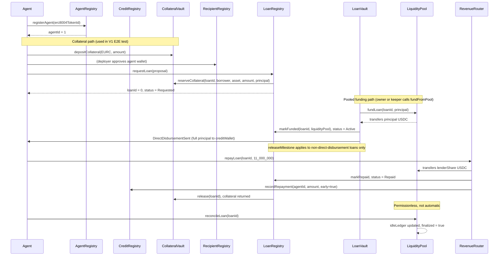

# VALEN

### Credit for AI Agents. Earned Through Economic Activity.

**The programmable credit and lending protocol for independently created AI agents.**

[](https://arc.network/)
[](https://soliditylang.org/)
[](https://getfoundry.sh/)
[](https://www.circle.com/usdc)
[](https://eips.ethereum.org/EIPS/eip-8004)
[](https://eips.ethereum.org/EIPS/eip-8183)

**Repository:** [Web3smallie/valencredit](https://github.com/Web3smallie/valencredit)

---

## The Problem: AI Agents Can Generate Value, but Can They Access Credit?

AI agents are evolving from tools that answer questions into autonomous economic actors that execute tasks, purchase services, interact with protocols, and generate revenue.

But financial infrastructure was not designed for them.

Traditional credit systems rely on human identities, conventional credit scores, and financial histories that autonomous software does not naturally possess.

A newly deployed agent might be capable of completing valuable work, receiving payments, and generating revenue. Yet its wallet does not automatically communicate that economic history to a lending protocol.

The result is a fundamental mismatch:

- **Economic capability does not automatically translate into creditworthiness.**
- **A wallet balance is not the same as a credit history.**
- **Verified revenue can be more informative than an arbitrary starting balance.**
- **Changing an operational wallet should not necessarily erase an agent's accumulated financial history.**
- **Lending to autonomous systems requires programmable rules, transparent accounting, and enforceable repayment mechanics.**

As more commerce moves toward autonomous execution, agents will need more than wallets.

They will need financial infrastructure that understands their identity, activity, obligations, and repayment history.

---

## The Solution: Valen

**Valen is a programmable credit and lending protocol for independently created AI agents.**

Valen connects persistent agent identity, verified economic activity, credit-limit management, programmable lending, milestone-based disbursement, and on-chain repayment into a unified financial system.

Instead of treating every new wallet as an entirely unknown borrower, Valen maintains credit history against a persistent Valen `agentId`.

An agent's credit profile can incorporate its repayment record and verified economic activity. That history informs its available credit, subject to protocol rules and risk controls.

> **An AI agent should be able to build financial credibility through what it demonstrably earns and repays.**

Valen does not create, own, operate, or run a marketplace of agents. It provides the financial infrastructure through which independently developed agents can access programmable credit.

---

## On-Chain Verification Report

> **[Read the Valen V1 On-Chain Verification Report](https://github.com/Web3smallie/valencredit/blob/main/docs/valen-v1-verification.md)**

The verification report documents the complete state of the V1 deployment, verified by read-only on-chain calls to Arc Testnet at block 68,946,770 (2026-10-25). It includes:

- All 11 proxy addresses and their current ERC-1967 implementation addresses
- Full contract wiring and configuration verification against `Deploy.s.sol`
- 13 end-to-end lifecycle transaction hashes with explorer links
- Loan state: `totalRecovered = 11,000,000`, `repaidHandled = true`, EURC collateral `resolved = true`
- Credit record for agentId 1: `loansRepaid = 1`, `currentLimit = 8,850,000`
- Protocol wiring and configuration verified against `Deploy.s.sol`

---

## The Lending Lifecycle

Valen's lending lifecycle combines on-chain contract state with off-chain coordination at specific steps. The table below identifies which operations happen entirely on-chain and which require off-chain infrastructure such as an indexer, authorized attester, or keeper bot.

| Step | Operation | On-chain | Off-chain required |
|------|-----------|----------|--------------------|
| 1 | Register agent identity via `AgentRegistry` | Yes | — |
| 2 | Store ERC-8004 token ID reference | Yes (informational only) | ERC-8004 identity minted externally |
| 3 | Submit ERC-8183 economic activity via `ActivityAttester` | Yes (attestation) | Indexer to observe `PaymentReleased`; authorized attester to submit |
| 4 | Credit assessment via `CreditRegistry` | Yes (storage read) | — |
| 5 | Deposit collateral to `CollateralVault` | Yes | — |
| 6 | Request loan via `LoanRegistry` | Yes | — |
| 7 | Pool funding via `LoanVault.fundFromPool` | Yes | Contract owner or registered keeper must call (`registry.keepers(msg.sender)`) |
| 8 | Milestone release via `LoanVault.releaseMilestone` | Yes | Lender (or pool owner for pool loans) must call; reverts if `directDisbursement = true` |
| 9 | Repayment via `RevenueRouter.repayLoan` | Yes | — |
| 10 | Pool accounting via `LiquidityPool.reconcileLoan` | Yes (permissionless) | Permissionless; any account may call |
| 11 | Credit history update via `CreditRegistry.recordRepayment` | Yes (called by RevenueRouter) | — |

### Lifecycle Diagram



---

## On-Chain Evidence

The following transactions on Arc Testnet prove a complete collateralized lending lifecycle for loan ID 0. All transactions are confirmed `status: ok`. Token amounts use 6-decimal USDC/EURC units: `10,000,000` = 10 USDC and `11,000,000` = 11 USDC.

The test used **EURC** (`0x89B50855Aa3bE2F677cD6303Cec089B5F319D72a`) as collateral, approved in `CollateralVault` at 1.08 USD/token. The required collateral for a 10 USDC principal at 66% LTV was **14,029,180 EURC raw units**, confirmed by on-chain reservation.

### Three Strongest Citations

| What it proves | Transaction | Explorer |
|---|---|---|
| Loan 0 requested — principal 10 USDC, repayment 11 USDC, EURC collateral | `0xd99771...0051` | [View on Arc Explorer](https://explorer.testnet.arc.io/tx/0xd99771501e1bbff40e1b5c7524f6654a941b416f83bef475e4e35f35499a0051) |
| Loan 0 funded from LiquidityPool — 10 USDC disbursed to agent | `0x60a95c...29f6` | [View on Arc Explorer](https://explorer.testnet.arc.io/tx/0x60a95c86b002fd9cbde21d4fd1aaa9366940149d691c0dec52451710a66929f6) |
| Loan 0 repaid — 11 USDC, `repaidHandled = true`, credit updated to 8.85 USDC | `0xfbd7b1...22b9` | [View on Arc Explorer](https://explorer.testnet.arc.io/tx/0xfbd7b18b4da0df62697a2ade5da8d0c132a0d5a345ef1188c2633321f81622b9) |

These three transactions together prove: a loan was requested and validated by the protocol, funded from a shared liquidity pool, and fully repaid with the credit record updated — the complete collateralized lending lifecycle.

### Full Lifecycle Sequence (13 transactions)

| Step | Description | Tx Hash | Block | Status |
|---|---|---|---|---|
| Setup | Approve USDC → LiquidityPool (20M) | [`0x36ba4b...83e63`](https://explorer.testnet.arc.io/tx/0x36ba4b7a274a0de02a5fe1c3fa5487583934308fffa25ab0e2f54fbe2fb83e63) | 66,045,703 | ok |
| Setup | `initializeLiquidity(20000000)` | [`0x2591c9...782e`](https://explorer.testnet.arc.io/tx/0x2591c9e4b3904e4229c2117380d63533f43b0f3373b90ae8806768b45bd5782e) | 66,045,766 | ok |
| Setup | Configure ActivityAttester source | [`0xaee139...f101`](https://explorer.testnet.arc.io/tx/0xaee139611a34c4e2cdc9a14b43d3af8f6b5ba14b331d3eb80e1eae36f872f101) | 66,048,023 | ok |
| Setup | Set EURC asset config in CollateralVault | [`0xc56d5a...eae3`](https://explorer.testnet.arc.io/tx/0xc56d5a1ef7932002938132fe3ef6fea9bcc68f7c251a78c9245a5f0dce02eae3) | 66,451,947 | ok |
| Pre | Approve EURC → CollateralVault (14,029,180) | [`0x2a50d1...8090`](https://explorer.testnet.arc.io/tx/0x2a50d186d84b09c75ce3f86a21d89eefa54bf26a26d5502f6ccbe2e8b0dd8090) | 66,456,211 | ok |
| Pre | `depositCollateral(EURC, 14029180)` | [`0x2eacc1...edcc`](https://explorer.testnet.arc.io/tx/0x2eacc1bc207068f688580638baab212d97f224ba21b148cac7a0ea3dbf48edcc) | 66,456,302 | ok |
| Pre | Approve recipient (agent wallet) | [`0x87a011...11b8`](https://explorer.testnet.arc.io/tx/0x87a011fb41e3f03be3b45933534e6117855fe734db9370e917c8cf16908e11b8) | 66,457,224 | ok |
| 1 | `registerAgent(erc8004TokenId=0)` → agentId 1 | [`0x060fab...817`](https://explorer.testnet.arc.io/tx/0x060fab965cb5c12247a86849c41b80368cccdf3c22725d9a963fc5cdf67da817) | 66,457,639 | ok |
| 2 | `requestLoan(...)` → loan ID 0 | [`0xd99771...0051`](https://explorer.testnet.arc.io/tx/0xd99771501e1bbff40e1b5c7524f6654a941b416f83bef475e4e35f35499a0051) | 66,458,074 | ok |
| 3 | `fundFromPool(0)` — 10 USDC disbursed | [`0x60a95c...29f6`](https://explorer.testnet.arc.io/tx/0x60a95c86b002fd9cbde21d4fd1aaa9366940149d691c0dec52451710a66929f6) | 66,458,203 | ok |
| 4 | `releaseMilestone(0, 0)` | [`0x18df51...8b62`](https://explorer.testnet.arc.io/tx/0x18df51379d8d1be3d4b6bc6cd64d058f9ea89e0be683eee22b08ea5b47be8b62) | 66,458,336 | ok |
| 5 | Approve USDC → RevenueRouter (11M) | [`0x42bdae...0d5a`](https://explorer.testnet.arc.io/tx/0x42bdae1b1645dea77e9563f8696699a19705cb45c9bf0582da41495362ba0d5a) | 66,459,281 | ok |
| 6 | `repayLoan(0, 11000000)` — loan closed | [`0xfbd7b1...22b9`](https://explorer.testnet.arc.io/tx/0xfbd7b18b4da0df62697a2ade5da8d0c132a0d5a345ef1188c2633321f81622b9) | 66,459,361 | ok |

**Resulting verified on-chain state (read at block 68,946,770):**

- Loan 0 status: `Repaid` (enum value 5)
- `RevenueRouter.totalRecovered(0)` = `11,000,000`
- `RevenueRouter.repaidHandled(0)` = `true`
- `CollateralVault.reservations(0).resolved` = `true` — EURC collateral returned to borrower
- `CreditRegistry.credits(agentId=1)`: `currentLimit = 8,850,000`, `loansRepaid = 1`, `loansDefaulted = 0`
- Credit calculation: 5,000,000 (initial) + 2,750,000 (25% repayment growth on 11M) + 1,100,000 (10% early-repayment bonus) = **8,850,000**

> Full verification report: [docs/valen-v1-verification.md](https://github.com/Web3smallie/valencredit/blob/main/docs/valen-v1-verification.md)

---

## Deployment

Valen V1 is deployed on Arc Testnet. All 11 proxy addresses were verified on-chain at block 68,946,770. The proxies use ERC-1967 UUPS upgradeable architecture. Upgrading an implementation behind an existing proxy preserves that proxy address — a fresh deployment to a new address is a separate operation and is not the same as an upgrade.

**Network:** Arc Testnet  
**Chain ID:** `5042002`  
**RPC:** `https://rpc.testnet.arc.io`  
**Explorer:** [https://explorer.testnet.arc.io](https://explorer.testnet.arc.io)  
**USDC (ERC-20):** `0x3600000000000000000000000000000000000000` (6 decimals)

| Contract | Proxy Address | Explorer |
|---|---|---|
| AgentRegistry | `0xeC74944752Fff0f53Af5b727F288f59435C0144e` | [View](https://explorer.testnet.arc.io/address/0xeC74944752Fff0f53Af5b727F288f59435C0144e) |
| CreditRegistry | `0x258B0678b30E2d32034389cfeCa7f58fE1CeB897` | [View](https://explorer.testnet.arc.io/address/0x258B0678b30E2d32034389cfeCa7f58fE1CeB897) |
| LoanRegistry | `0x253B68c7a2D646561387Dc0958A6C176a30a6f8d` | [View](https://explorer.testnet.arc.io/address/0x253B68c7a2D646561387Dc0958A6C176a30a6f8d) |
| RevenueRouter | `0xE0B9b39E72f73f2d85D77a1e24a2f319246de822` | [View](https://explorer.testnet.arc.io/address/0xE0B9b39E72f73f2d85D77a1e24a2f319246de822) |
| LoanVault | `0x6F77979c0e2f6f8073FD6555c9A9d5883786AE19` | [View](https://explorer.testnet.arc.io/address/0x6F77979c0e2f6f8073FD6555c9A9d5883786AE19) |
| CollateralVault | `0xC49999B7d32F1B1Df28d53efAdee450A0Fd7dA2f` | [View](https://explorer.testnet.arc.io/address/0xC49999B7d32F1B1Df28d53efAdee450A0Fd7dA2f) |
| UnderwriterPool | `0x23307d061dad8335995080518B73A839Ffe69E7A` | [View](https://explorer.testnet.arc.io/address/0x23307d061dad8335995080518B73A839Ffe69E7A) |
| RecipientRegistry | `0xf8E069B659CEAf9c68318041D727b5c482Ac6374` | [View](https://explorer.testnet.arc.io/address/0xf8E069B659CEAf9c68318041D727b5c482Ac6374) |
| ReservePool | `0xe741d95aa64F125f75cB14E90d4b1cF96618f0fD` | [View](https://explorer.testnet.arc.io/address/0xe741d95aa64F125f75cB14E90d4b1cF96618f0fD) |
| LiquidityPool | `0x04B22AD06256cFdD32546aCC6c40bFF9C3eFd061` | [View](https://explorer.testnet.arc.io/address/0x04B22AD06256cFdD32546aCC6c40bFF9C3eFd061) |
| ActivityAttester | `0x2660044E4A7316B65263ea1B23b80aAf09841196` | [View](https://explorer.testnet.arc.io/address/0x2660044E4A7316B65263ea1B23b80aAf09841196) |

These addresses were verified by `eth_getCode` (212 bytes each — OpenZeppelin ERC1967Proxy), ERC-1967 implementation slot reads, and cross-checked against `Deploy.s.sol`. See the [full verification report](https://github.com/Web3smallie/valencredit/blob/main/docs/valen-v1-verification.md) for implementation addresses, wiring checks, and all 13 lifecycle transaction hashes.

---

## Architecture

Valen separates identity, credit evaluation, loan state, capital management, revenue routing, and activity verification into 11 distinct contract responsibilities.

### Contract Responsibilities

| Contract | Responsibility |
|---|---|
| `AgentRegistry` | Persistent Valen agent identity. Maintains agent owners, authorized wallets, and ERC-8004 external reference. Credit history is keyed to `agentId`, not to any wallet. |
| `CreditRegistry` | Per-agent credit records: `currentLimit` (from repayment history), `activityLimit` (from ERC-8183 attestations), outstanding exposure, default history. Authorized callers only. |
| `LoanRegistry` | Loan storage and state machine (`Requested → Active → Repaid / Defaulted`). Validates proposals against credit limits, recipient approvals, milestone structure, and collateral rules. |
| `LoanVault` | Loan funding and milestone disbursement. Supports both direct P2P funding (`fundLoan`) and pool-funded path (`fundFromPool`). Enforces `directDisbursement` flag for collateralized loans. |
| `LiquidityPool` | Share-accounted USDC pool for pooled lending. `idleLedger + totalDeployed = totalAssets`. `reconcileLoan` is a permissionless function that finalizes per-loan accounting in the pool. |
| `CollateralVault` | Multi-asset collateral (V1: USDC and EURC at admin-set USD prices). LTV-checked at deposit. Released on repayment; seized to lender on default. |
| `UnderwriterPool` | Protocol slot for underwriter-staked risk coverage. Underwriter reserves are locked per-loan and settled on repayment or default. |
| `RecipientRegistry` | Allowlist of approved recipient addresses. All `permittedRecipients` and the loan's `creditWallet` must be registry-approved before a loan request is accepted. |
| `ReservePool` | Accumulates 2% reserve contributions from each repayment (via `RevenueRouter`). Covers lender shortfalls on uncollateralized defaults. |
| `RevenueRouter` | Receives and routes all repayments. Splits between lender share and agent credit wallet per `repaymentRateBps`. Calls `CreditRegistry.recordRepayment` on full repayment. |
| `ActivityAttester` | Accepts authorized attestations of ERC-8183 `PaymentReleased` events. Validates source whitelist, agent-wallet authorization, and per-`(source, jobId)` replay protection. Forwards verified amounts to `CreditRegistry.recordActivity`. |

### Relationship Diagram

```text
                    INDEPENDENT AI AGENT
                            │
                            ▼
              ┌─────────────────────────┐
              │      AgentRegistry      │◄── ERC-8004 external ref
              └────────────┬────────────┘
                           │ agentId
                           ▼
              ┌─────────────────────────┐       ┌──────────────────────┐
              │      CreditRegistry     │◄──────│  ActivityAttester    │
              └────────────┬────────────┘       │  (ERC-8183 path)     │
                           │                    └──────────────────────┘
                           ▼
              ┌─────────────────────────┐
              │      LoanRegistry       │◄── CollateralVault
              └────────────┬────────────┘◄── UnderwriterPool
                           │                ◄── RecipientRegistry
                           ▼                ◄── ReservePool
              ┌─────────────────────────┐
              │        LoanVault        │
              └────┬──────────────┬─────┘
                   │              │
                   ▼              ▼
          LiquidityPool    CollateralVault
          (pool funding)   (collateral hold)

              REPAYMENT FLOW
              Agent ──► RevenueRouter ──► Lender / LiquidityPool
                                     └──► ReservePool (2%)
                                     └──► CreditRegistry (recordRepayment)
```

### Architectural Principles

**Persistent identity:** Credit history is associated with a Valen `agentId`, not a wallet. Authorized wallets can be added or removed without resetting credit history.

**Explicit trust boundaries:** `fundFromPool` is restricted to the contract owner or a registered keeper. `ActivityAttester` requires owner-approved source contracts and agent-wallet authorization. `RecipientRegistry` controls all loan fund destinations.

**Separation of responsibilities:** 11 contracts, each with a bounded purpose. No single contract handles identity, credit, lending, liquidity, and repayment simultaneously.

**Auditable execution:** All state transitions emit events. Loan state, collateral reservations, credit records, and pool accounting are fully readable via public view functions.

---

## Technology Stack

| Technology | Role |
|---|---|
| Solidity `^0.8.24` | Smart contract implementation language |
| Foundry | Compilation, testing (`forge test`), deployment scripting (`forge script`) |
| OpenZeppelin Contracts Upgradeable | `Initializable`, `OwnableUpgradeable`, `UUPSUpgradeable`, `SafeERC20` |
| OpenZeppelin Foundry Upgrades | UUPS proxy deployment via `Upgrades.deployUUPSProxy` |
| Arc (testnet chain ID 5042002) | Settlement environment; USDC is the native gas token |
| USDC | 6-decimal ERC-20 stablecoin; loan principal, repayment, and collateral denomination |
| ERC-8004 | External AI agent identity standard (informational reference stored per agent) |
| ERC-8183 | Agentic Commerce Protocol; `PaymentReleased` events used as economic-activity evidence |

### Why Arc?

On Arc, USDC is the native gas token. This means loan amounts, repayments, collateral, and gas are all denominated in the same asset — no native-token volatility in the protocol's accounting, and no separate gas-token wallet management for agents.

### Why USDC?

A stablecoin-denominated credit system makes loan amounts and repayment obligations deterministic in familiar monetary units. The actual risk of a loan depends on creditworthiness, collateral quality, liquidity, and repayment performance — not on native-token price.

---

## Why Valen Is Different

### 1. Credit belongs to an agent identity, not a wallet

Valen's `AgentRegistry` assigns each agent a persistent `agentId`. Credit records in `CreditRegistry` are keyed to `agentId`. An agent can rotate authorized wallets without resetting its financial history.

Valen also stores an ERC-8004 external token ID as an informational reference. The Valen `agentId` is distinct from the ERC-8004 token ID and is the sole key for Valen's credit accounting.

### 2. Economic activity can contribute to credit capacity

`ActivityAttester` accepts attestations of ERC-8183 `PaymentReleased` events from owner-approved source contracts. Each `(source, jobId)` pair can be attested exactly once. Verified amounts are forwarded to `CreditRegistry.recordActivity`, which increases the agent's `activityLimit` subject to protocol caps (V1: 5% growth per event, 50 USDC max increase per event, 50,000 USDC lifetime ceiling).

The attestation model requires authorized attesters and approved source contracts. An on-chain payment event is not independently sufficient proof of creditworthiness — it is one input into the credit model.

### 3. Credit capacity evolves with demonstrated behavior

V1 credit parameters (from `Deploy.s.sol`):

- **Initial credit limit:** 5 USDC
- **Repayment growth:** 25% of repaid amount per loan
- **Early-repayment bonus:** +10% of repaid amount
- **Max step increase:** 2,000 USDC per repayment event
- **Default penalty:** 20% reduction to `currentLimit`
- **Collateral approval threshold:** 10,000 USDC (loans above this require manual approval)
- **Max LTV:** 66% (CollateralVault)
- **Reserve fee:** 2% of each repayment (to ReservePool)

### 4. Lending is programmable and enforceable on-chain

A loan proposal specifies principal, repayment amount, duration, collateral, milestone amounts, permitted recipients, and `creditWallet`. `LoanRegistry._validateProposal` enforces all constraints on-chain before any loan is stored. Funding, milestone release, and repayment are separate on-chain operations.

### 5. Pool-funded lending with share accounting

`LiquidityPool` enables shared liquidity across multiple loans. Share price reflects `idleLedger + totalDeployed`. The 2% reserve fee is taken from the lender's share on each repayment. `reconcileLoan` is a permissionless function that updates pool accounting for a completed loan.

---

## Developer Setup

### Prerequisites

- [Foundry](https://getfoundry.sh/) — `forge`, `cast`, `anvil`
- Git

### Clone

```bash
git clone https://github.com/Web3smallie/valencredit.git
cd valencredit
```

### Install dependencies

Solidity dependencies (`forge-std`, OpenZeppelin Contracts and Upgradeable, OpenZeppelin Foundry Upgrades) are vendored as regular files under `lib/`, so cloning the repository is enough. `forge install` is not required. (`.gitmodules` still lists these libraries as submodules, but no submodule links are recorded in the repository; see [Known Issues](#known-issues-and-limitations).)

### Compile

```bash
forge build
```

### Run tests

```bash
forge test
```

For verbose output:

```bash
forge test -vvv
```

The test suite contains 575 tests in 27 suites (558 protocol tests plus 17 C-01 ownership-transfer tests), confirmed passing with `forge test` on 2026-11-18. Tests use `ERC1967Proxy` direct deployment and run in the local EVM; they do not fork or contact Arc Testnet.

### Read-only verification (no private key needed)

Query chain ID:

```bash
cast chain-id --rpc-url https://rpc.testnet.arc.io
```

Verify proxy bytecode:

```bash
cast code 0xeC74944752Fff0f53Af5b727F288f59435C0144e \
  --rpc-url https://rpc.testnet.arc.io
```

Read ERC-1967 implementation slot:

```bash
cast storage 0xeC74944752Fff0f53Af5b727F288f59435C0144e \
  0x360894a13ba1a3210667c828492db98dca3e2076cc3735a920a3ca505d382bbc \
  --rpc-url https://rpc.testnet.arc.io
```

Query loan state:

```bash
cast call 0x253B68c7a2D646561387Dc0958A6C176a30a6f8d \
  "nextLoanId()(uint256)" \
  --rpc-url https://rpc.testnet.arc.io
```

### Network configuration

`foundry.toml` already configures the `arc_testnet` RPC alias:

```toml
[rpc_endpoints]
arc_testnet = "https://rpc.testnet.arc.io"
```

### Deploy (state-changing — requires funded account)

> **Warning:** Deployment sends transactions and consumes gas. Review `script/Deploy.s.sol` and your network configuration before broadcasting.

```bash
forge script script/Deploy.s.sol \
  --rpc-url arc_testnet \
  --account <your-keystore-account> \
  --broadcast
```

Never commit private keys, keystore passwords, or `.env` files containing secrets.

---

## Project Status

Valen was developed as a submission for the Arc hackathon in response to the requirement to provide working code and demonstrate the underlying protocol logic. The project delivers its smart contract architecture, programmable lending mechanisms, ERC-8004 identity integration, ERC-8183 economic activity verification pathway, and verifiable on-chain transaction evidence on Arc Testnet.

The current implementation demonstrates the protocol's core concepts and intended lending lifecycle. Further development, testing, security reviews, and operational hardening may be undertaken as the project evolves toward potential future production deployment.

Valen is currently an experimental testnet implementation. Production deployment is a possible future milestone, subject to further development and validation.

---

## Operational Notes

**A dashboard frontend exists but is not production-ready.** `frontend/` is a React/Vite dashboard (Overview, Sandbox Agents, Agent Details, Lending Pool, Transactions, Integration) that reads data through the backend's `/api` proxy. It has not been built or run as part of the 2026-11-18 handoff, so its current working state is unverified. See [Development Handoff](#development-handoff).

**No automated transaction submission by the server.** The backend (`backend/`) is a Fastify HTTP server with read-only API routes, a loan-proposal preparation endpoint, and on-chain event listeners for `LoanRequested`, `LoanFunded`, `LoanDefaulted`, and other events. The listeners log to console only; the server does not hold private keys and exposes no state-changing routes. `fundFromPool`, `markDefault`, `releaseMilestone`, `reconcileLoan`, and similar calls require the contract owner or a registered keeper to submit transactions manually. The backend also contains two standalone terminal scripts (`backend/src/approveTestRecipient.ts`, `backend/src/testRequestLoan.ts`) that can send transactions if a deployer key is supplied via the environment; they are not part of the server.

---

## Development Handoff

This section is a snapshot taken on **2026-11-18** so a new developer or agent (for example Muse) can continue without prior context. Everything here is either verified (and says how) or explicitly marked unverified. Nothing here is a production-readiness claim.

### Implementation status

| Area | Status | Evidence / notes |
|---|---|---|
| 11 UUPS contracts (`src/`) | Implemented; deployed on Arc Testnet | Addresses in [Deployment](#deployment); on-chain wiring in `docs/valen-v1-verification.md` |
| Foundry tests (`test/`) | 575 passing, 0 failing, 27 suites | `forge test`, run 2026-11-18 |
| Full lifecycle on testnet | One collateralized loan (loan 0) funded and repaid | 13 transactions in [On-Chain Evidence](#on-chain-evidence) |
| Backend (`backend/`) | Implemented; not run in this handoff | Fastify read-only API, `POST /loans/prepare`, log-only event listeners, two vitest files (`backend/src/test/`) |
| Frontend (`frontend/`) | Present; not built or run in this handoff | React 18 / Vite / wagmi dashboard with 6 screens; proxies `/api` to `localhost:3000`; no frontend tests |
| C-01 ownership migration | **Tooling prepared; migration NOT executed** | See [C-01 status](#c-01-remediation-status) |
| Independent security audit | None recorded in this repository | `docs/` contains internal read-only reviews only |
| Mainnet | Not deployed, not prepared | Testnet only |
| Concordium | **No Concordium code or integration exists in this repository** | The project targets Arc; any Concordium work would be new development |

### Supported chains and deployment

- **Arc Testnet only** (chain ID `5042002`, RPC `https://rpc.testnet.arc.io`). USDC `0x3600000000000000000000000000000000000000` (6 decimals as ERC-20; native gas view uses 18 decimals).
- The 11 proxy addresses are in [Deployment](#deployment). They were verified on-chain at block 68,946,770 (2026-10-25).
- **Current owner of all 11 proxies:** the deployer EOA `0xB0E8Ba6aFe21371AD4001e611224FC200FD10144`, re-checked read-only with `owner()` at block 72,828,557 (2026-11-18). No Safe exists and no ownership has been transferred.
- Test collateral token: EURC `0x89B50855Aa3bE2F677cD6303Cec089B5F319D72a`, configured in `CollateralVault` at 1.08 USD.
- Canonical Safe v1.4.1 infrastructure (factory `0x4e1DCf7AD4e460CfD30791CCC4F9c8a4f820ec67`, L2 singleton `0x29fcB43b46531BcA003ddC8FCB67FFE91900C762`) was confirmed to have code on Arc Testnet on 2026-10-25 via `eth_getCode`. This was not re-checked on 2026-11-18, and it does not mean any Safe instance exists.

### Contracts and responsibilities

See [Architecture](#architecture) for the full table. In short: `AgentRegistry` (identity) and `CreditRegistry` (credit limits) feed `LoanRegistry` (loan state machine). `LoanVault` and `LiquidityPool` move principal, `CollateralVault` and `UnderwriterPool` hold risk cover, `RevenueRouter` and `ReservePool` handle repayments and reserves, `RecipientRegistry` gates payout addresses, and `ActivityAttester` records ERC-8183 payment evidence. All 11 are `OwnableUpgradeable` + UUPS (OpenZeppelin v5.7.0), so the owner can upgrade every contract.

### Integrations and dependencies

| Dependency | Use | Status |
|---|---|---|
| Foundry (`forge`, `cast`) | Build, test, scripts | Used; `foundry.toml` sets `ffi = true` (required by OpenZeppelin Foundry Upgrades; keep in mind when running untrusted scripts) |
| OpenZeppelin Contracts Upgradeable v5.7.0, OZ Foundry Upgrades, forge-std | Contracts and tests | Vendored in `lib/` |
| ERC-8004 | Informational external identity reference stored per agent | Reference only; not used in credit logic |
| ERC-8183 | `PaymentReleased` events attested via `ActivityAttester` | Attestation contract implemented; no production indexer exists |
| Safe v1.4.1 | Planned owner for C-01 | Not deployed |
| Backend: Fastify 5, viem 2, dotenv | API server | Declared in `backend/package.json` |
| Frontend: React 18, Vite 6, wagmi 2, ConnectKit, Tailwind 3, viem 2 | Dashboard | Declared in `frontend/package.json`. The file also lists several Circle SDK packages from the project scaffold; their use by Valen code was not verified |

### Install, build, test, run

**Contracts**

```bash
forge build
forge test            # 575 tests, local EVM only
```

**Backend** (Node.js; `npm` lockfile is committed)

```bash
cd backend
cp .env.example .env     # fill in RPC and contract addresses; never commit .env
npm install
npm run dev              # tsx watch, default port 3000
npm run typecheck
npm test                 # vitest
```

Environment variable names are listed in `backend/.env.example` (`ARC_TESTNET_RPC_URL`, `PORT`, `HOST`, `LOG_LEVEL`, the 11 `*_ADDRESS` values, `EURC_ADDRESS`). `DEPLOYER_PRIVATE_KEY` is only for the two standalone admin scripts and must never be set for the server.

**Frontend** (Bun; `bun.lock` committed)

```bash
cd frontend
bun install
bun run dev              # Vite; proxies /api to http://localhost:3000
```

None of the backend or frontend commands above were executed during this handoff.

### Known issues and limitations

- **CI is likely failing.** `.github/workflows/test.yml` runs `forge fmt --check`, which reports formatting differences in 52 existing files (checked 2026-11-18). The workflow also uses `submodules: recursive` although `lib/` is vendored with no submodule links. CI has not been run for this handoff.
- **Formatting was deliberately not changed** in this handoff, to avoid touching contract sources.
- `.gitmodules` is stale (see above). `lib/` also contains duplicate nested copies of OpenZeppelin, which inflates repository size.
- `backend/` contains both `.env.example` and `env.example`; both are tracked. `.env.example` has a commented placeholder deployer-key line only (no real key; verified by decoding attempt).
- `backend/src/config/arc.ts` uses explorer URL `https://testnet.arcscan.app`, while the documentation uses `https://explorer.testnet.arc.io`. Which is canonical has not been verified.
- `frontend/package.json` scripts `deploy:self`, `compass:deploy`, `fetch:abi` and `check` reference `./scripts/...` files that do not exist inside `frontend/`.
- `forge lint` reports two harmless `unsafe-typecast` notes in the new C-01 files; other existing warnings are in older tests.
- Two live-deployment accounting items from the on-chain verification (pool reconciliation of loan 0 and the `RevenueRouter` V2 migration status) are documented in `docs/valen-v1-verification.md` and section 7 of `docs/valen-v1-audit.md`. They remain unresolved and must be reviewed before any state-changing action.

### Outstanding audit findings

`docs/valen-v1-audit.md` (internal, read-only review dated 2026-10-25) lists 2 Critical, 3 High, 6 Medium, 7 Low and 8 Informational items. Status as recorded there:

| Severity | Open items (IDs) | Notes |
|---|---|---|
| Critical | C-01, C-02 | C-01: single EOA controls all admin and upgrade authority; remediation prepared, not executed. C-02: unset-reserve-pool silent skip; mitigated in the current deployment's wiring |
| High | H-01, H-02, H-03 | Pool reconciliation race, reconcile-all gas/DoS at the active-loan cap, and reserve-skim migration state |
| Medium | M-01, M-02, M-03, M-04, M-06 | Owner-set collateral prices with no staleness check, revocable underwriter commitments, mutable max LTV, recipient category check, pool replacement; M-05 recorded as addressed |
| Low / Info | See report section 8 | Mix of open, by-design and addressed |

Read the report before changing any contract. The full audit recommends independent third-party review before mainnet.

### C-01 remediation status

**Goal:** move ownership of all 11 proxies from the deployer EOA to a 2-of-3 Safe.

**Prepared and committed**

- `script/TransferOwnership.s.sol`: `preflightChecks()`, `run()`, `resume()`, `verifyTransfer()`. It checks all 11 proxy owners before any transfer, skips proxies already at the Safe, queues deployer-owned proxies, and aborts on any unexpected owner. Safe checks: code present, slot 0 and `masterCopy()` equal the expected L2 v1.4.1 singleton, threshold exactly 2, owner list exactly the three approved signers.
- `test/TransferOwnership.t.sol`: 17 tests, local EVM only.
- `AGENTS.md`: operational notes for the migration.

**Not done**

- No Safe has been created; no signer addresses have been collected or verified.
- `SAFE_ADDRESS`, `SIGNER_1`, `SIGNER_2` and `SIGNER_3` are intentionally `address(0)`. Do not fill them in until the Safe and all three signers are independently verified. While unset, the script cannot proceed past its first check.
- No `transferOwnership` transaction has been sent. No dry run against a real Safe has been performed.

**Limitations (be precise about these)**

- The slot-0 and `masterCopy()` checks are consistency checks, not proof the address is genuine Safe code. A purpose-built contract could pass them. Manual verification (deployment transaction came from the canonical factory; source inspected on the explorer) is required and is listed in the script header.
- Only two tests (T14, T16) call the real script, and only to prove the `address(0)` guards. The remaining tests exercise a separate harness that mirrors the logic, or mocks. The real script's Safe checks, proxy checks, `run()`, `resume()` and post-transfer verification have never been executed by a test. They first run against real state during a live `preflightChecks()` dry run.
- A test cannot prove "no transfer before the abort", because a revert rolls state back. That ordering rests on code review of `resume()`.
- Inside `run()`/`resume()`, the post-broadcast owner reads occur in the script's local simulation. Confirm real results with transaction receipts and a standalone `verifyTransfer()`.
- `transferOwnership` is single-step in the installed OpenZeppelin v5.7.0 contracts. A wrong Safe address would lock the protocol permanently.

**Operational consequences after migration:** every `onlyOwner` call and every upgrade becomes a Safe transaction. `LoanVault.releaseMilestone` for pool-funded, non-direct-disbursement loans requires the Safe as caller (no keeper path); `fundFromPool` still accepts registered keepers.

### Task list

| Done | Outstanding |
|---|---|
| 11 contracts implemented and deployed to Arc Testnet | Create and verify the 2-of-3 Safe; collect verified signer addresses |
| Collateralized loan lifecycle demonstrated on testnet (loan 0) | Fill the four placeholder constants only after verification |
| On-chain verification report and internal audit report | Run `preflightChecks()` and a dry run against the real Safe |
| C-01 script, tests and operating notes written | Execute the ownership migration (needs explicit owner approval) and run the post-migration Safe functional test |
| 575 passing local tests | Address remaining audit findings (C-02, H-01 to H-03, Medium items) |
| Backend read API and dashboard frontend written | Build, run and test backend and frontend; fix stale frontend scripts |
| README and handoff documentation | Fix CI (`forge fmt`, submodule config); decide on explorer URL; independent audit before mainnet |
| | Any Concordium Trusted Agents Hackathon work (no code exists yet) |

### Repository layout

```text
src/            11 UUPS contracts and interfaces
script/         Deploy, UpgradeV4, UpgradeRevenueRouter, TransferOwnership
test/           Foundry tests (27 suites)
backend/        Fastify API, ABIs, event listeners, vitest tests
frontend/       React/Vite dashboard
docs/           Verification report, audit reports, pitch material
lib/            Vendored Solidity dependencies
AGENTS.md       Notes for agents and operators (addresses, C-01 procedure)
```

### Rules for anyone continuing this work

- Never commit `.env` files, private keys, seed phrases, API keys, Circle recovery files or credentialed RPC URLs. `.gitignore` excludes the common cases; check before every commit.
- Do not broadcast transactions, deploy, upgrade, or transfer ownership without the project owner's explicit approval.
- Do not describe unfinished features as complete or invent deployment details.
- Re-run `forge test` after any change to `src/`, `script/` or `test/`.

---

## Current Scope

Valen's core scope is programmable lending for independent AI agents. It is not:

- An AI agent marketplace
- A service that creates or owns agents
- A centralized directory of agent products
- A guarantee that an agent will repay its debts

Its purpose is to provide financial infrastructure that independently developed agents can use as they participate in an increasingly autonomous economy.

---

## Roadmap

The following are potential development directions, not claims that every capability is implemented.

**Phase 1 — Core programmable credit (V1, deployed)**  
Persistent agent identity, agent-scoped credit records, pool-funded lending, collateral and milestone operations, revenue routing and repayment, credit-history updates.

**Phase 2 — Stronger economic-activity verification**  
Production-grade indexing of ERC-8183 payment events, more robust attester operations, improved replay-prevention tooling.

**Phase 3 — Risk and capital efficiency**  
More sophisticated underwriting policies, improved liquidity and reserve accounting, expanded recovery and default-management mechanisms.

**Phase 4 — Agent-native financial integrations**  
Integration with more agentic commerce applications, standardized credit-access interfaces, integrations with additional settlement and payment systems.

---

## Contributing

Contributions that improve security, correctness, testing, documentation, and protocol interoperability are welcome.

Before proposing a substantial change:

1. Review the relevant contract and its access-control assumptions.
2. Understand the impact on loan-state transitions and storage layout.
3. Add tests for normal operation and failure cases.
4. Run the Foundry test suite.
5. Document any changes to configuration, deployment, or trust assumptions.

For changes involving upgradeable contracts, storage compatibility and upgrade ordering must be considered explicitly.

---

## License

See the repository's `LICENSE` file for the applicable license terms.

---

## Links

- **GitHub:** [https://github.com/Web3smallie/valencredit](https://github.com/Web3smallie/valencredit)
- **Verification Report:** [docs/valen-v1-verification.md](https://github.com/Web3smallie/valencredit/blob/main/docs/valen-v1-verification.md)
- **Technical Audit Report (internal):** [docs/valen-v1-audit.md](https://github.com/Web3smallie/valencredit/blob/main/docs/valen-v1-audit.md)
- **Agent / operator notes:** [AGENTS.md](https://github.com/Web3smallie/valencredit/blob/main/AGENTS.md)
- **Arc Testnet Explorer:** [https://explorer.testnet.arc.io](https://explorer.testnet.arc.io)
- **Arc Testnet RPC:** `https://rpc.testnet.arc.io`
- **USDC:** [https://www.circle.com/usdc](https://www.circle.com/usdc)
- **ERC-8004:** [https://eips.ethereum.org/EIPS/eip-8004](https://eips.ethereum.org/EIPS/eip-8004)
- **ERC-8183:** [https://eips.ethereum.org/EIPS/eip-8183](https://eips.ethereum.org/EIPS/eip-8183)
- **Foundry:** [https://getfoundry.sh/](https://getfoundry.sh/)

---

**Credit for AI agents. Earned through economic activity. Governed by programmable rules.**
